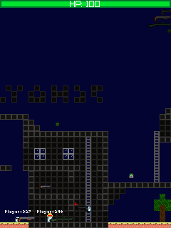

# shootan-j2me

This is a silly j2me port of [shootan](https://github.com/InviseDivine/shootan) online game made by my friend.

# Progress

The game is now **playable** on a real device (tested on Nokia E65).
99% of game protocol is implemented.

The BMFont Binary rendering is vibecoded now but planed to be rewritten by hand.

## TODO
- [ ] leaderboards
- [ ] rewrite font rendering
- [ ] local bluetooth multiplayer mode
- [ ] cute menus
- [ ] chat
- [ ] end round screen
- [ ] pause menu
- [ ] zombies for offline mode (maybe)
- [ ] code review and optimization
- [ ] maybe scale textures by 2 (because on 240x320 screen it looks so tiny)
- [ ] make space used more effectively in [spritesheet](./res/spritesheet.png)
- [ ] pspkvm support

# Resources used
- [shootan](https://github.com/InviseDivine/shootan) - the base game
- [enet-j2me](https://github.com/Kolyah35/enet-j2me) - networking
- [compress-j2me](https://github.com/igorgatis/compress-j2me) - decompressing levels
- [rd-132211](https://github.com/thecodeofnotch/rd-132211) - the base game uses timer and AABB from this game
- [grixel-acme](https://www.dafont.com/es/grixel-acme-9.font) - font that raylib default font inspired on
- [tiny-font](https://www.dafont.com/tiny.font) - for player names